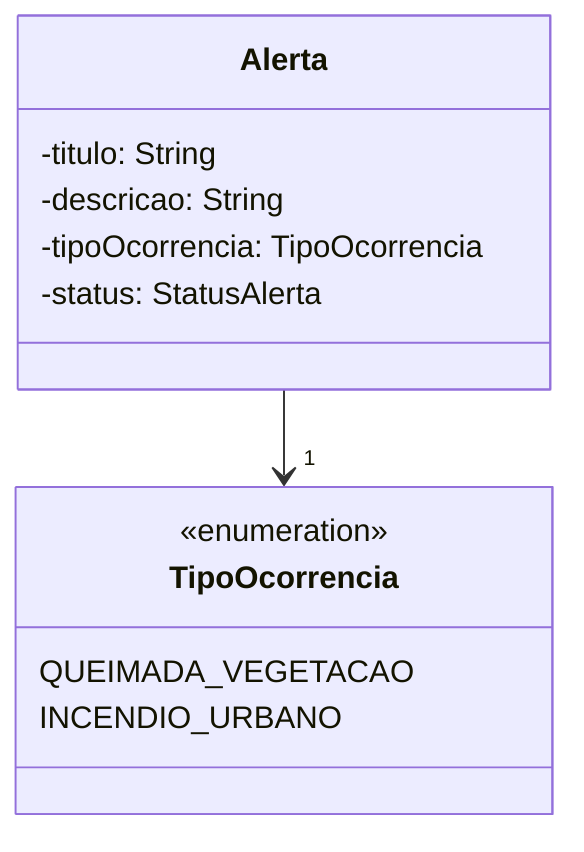

# Atualizações do documento do TCC para o IRS v2

Textos para colar no documento do TCC, refletindo a integração do IRS v2 (Etapas C a F), a persistência em banco de dados (Etapa G, Seção 5 deste arquivo) e o tipo de ocorrência (Etapa H, Seção 6), outubro de 2026.

> **Atenção:** o documento do TCC não estava disponível durante a redação. Os textos foram escritos a partir do sistema implementado, sem comparação com a redação atual. As seções são indicadas pelos identificadores usados no projeto (RF05, RF07, UC03, UC07, HU10, RNF01, RNF14, Quadro 2, Capítulos 5 a 7). Antes de colar, confira a numeração e ajuste os termos ao glossário do documento.

---

## 1. RF05: classificação de risco (nova redação)

> **RF05 – Classificar o risco da ocorrência.** O sistema deve classificar automaticamente o risco de cada ocorrência registrada em quatro níveis (Baixo, Moderado, Alto e Crítico), por meio do Índice de Risco Sintético, versão 2 (IRS v2). O índice consiste na soma ponderada, com pesos obtidos pelo método AHP, de nove critérios normalizados entre 0 e 1:
>
> 1. área afetada;
> 2. proximidade urbana;
> 3. vento (intensidade e direção);
> 4. pessoas em risco;
> 5. taxa de propagação da área afetada;
> 6. bioma;
> 7. tipo de área atingida (terra indígena, unidade de conservação, APP, reserva legal, área rural ou urbana);
> 8. fauna ameaçada nas proximidades;
> 9. relevância ecológica (distância à unidade de conservação ou terra indígena mais próxima).
>
> Os critérios ambientais devem ser obtidos automaticamente de bases públicas a partir das coordenadas da ocorrência, permitindo ao operador corrigir o bioma e o tipo de área. Para cada ocorrência, o sistema deve registrar o índice, o nível, a contribuição de cada critério, a origem e a data de obtenção de cada dado e a versão do algoritmo utilizada.

---

## 2. UC07: passo 2 do fluxo principal (dados lidos para a classificação)

> **2.** O sistema lê os dados da ocorrência informados pelo operador: coordenadas, área afetada, intensidade e direção do vento, taxa de propagação, presença de pessoas em risco, tipo de ocorrência (queimada em vegetação ou incêndio em área urbana) e, quando corrigidos pelo operador, bioma e tipo de área. Para as coordenadas da ocorrência, o sistema obtém das bases públicas:
>
> - o bioma (IBGE);
> - a unidade de conservação que contém o ponto ou está próxima (ICMBio);
> - a terra indígena que contém o ponto ou está próxima (FUNAI);
> - as espécies animais ameaçadas registradas a até 50 km (GBIF);
> - os focos de calor registrados a até 50 km nos últimos sete dias (INPE).
>
> Os valores informados pelo operador prevalecem sobre os detectados.

Fluxo alternativo sugerido para o mesmo caso de uso:

> **FA – Base pública indisponível (no passo 2).** Se uma base pública não responder dentro do tempo limite, o sistema utiliza um valor de reserva para o critério correspondente, registra a fonte efetivamente utilizada e prossegue com a classificação. A indisponibilidade de bases externas não impede o registro da ocorrência.

---

## 3. Capítulo 5: endpoints e campos novos

### 3.1 Endpoints (acrescentar à tabela de rotas da API)

| Método | Rota | Descrição |
| :--- | :--- | :--- |
| GET | `/api/alertas/geodados-preview?lat=&lng=` | Retorna os dados ambientais de um ponto (bioma, unidade de conservação, terra indígena, fauna ameaçada e focos de calor) sem registrar ocorrência. Responde 400 para coordenadas inválidas. |
| GET | `/api/alertas/:id/geodados` | Retorna os dados ambientais registrados na ocorrência; na ausência deles, consulta as bases em tempo real, sem registrar o resultado. |

Rotas existentes com comportamento alterado:

| Método | Rota | Alteração |
| :--- | :--- | :--- |
| POST | `/api/alertas` | Passa a classificar a ocorrência pelo IRS v2 e aceita os campos opcionais `bioma` e `tipoArea` (correções do operador). |
| GET | `/api/alertas/:id/risco` | Passa a retornar o cálculo registrado na criação da ocorrência, com os nove critérios e a versão do algoritmo, em vez de recalculá-lo a cada consulta. |

Todas as rotas continuam exigindo autenticação por token JWT.

### 3.2 Campos novos da ocorrência (acrescentar ao modelo de dados ou ao dicionário de dados)

| Campo | Tipo | Descrição |
| :--- | :--- | :--- |
| `irs` | número (0 a 1) | Índice de Risco Sintético (mantém-se também `pontuacaoRisco`, com o mesmo valor) |
| `sigmoide` | número (0 a 1) | Valor da função sigmoide aplicada ao IRS, usado para definir o nível |
| `detalhes` | objeto | Para cada um dos nove critérios: valor de entrada, fator, peso, contribuição e origem do dado |
| `bioma` / `biomaOrigem` | texto | Bioma considerado no cálculo e sua origem ("detectado" ou "informado") |
| `tipoArea` / `tipoAreaOrigem` | texto | Tipo de área considerado e sua origem ("detectado" ou "informado") |
| `areaCriticaFauna` | texto | Nível de fauna ameaçada considerado (crítica, ameaçada, vulnerável, sem espécies, urbana) |
| `proximaUC` | booleano | Indica unidade de conservação ou terra indígena a menos de 10 km |
| `geodados` | objeto | Dados ambientais consultados, com a fonte (`fontes`) e a data de obtenção (`obtidoEm`) de cada um |
| `versaoAlgoritmo` | texto | Versão do algoritmo de classificação ("IRS v2"; ocorrências sem o campo são tratadas como "IRS v1") |

### 3.3 Componentes novos (diagrama de componentes ou de classes do backend)

- **`classificacaoService`:** integra a ocorrência ao IRS v2. Obtém os geodados, aplica as correções do operador e calcula o índice.
- **`geodadosService`:** consulta IBGE, ICMBio, FUNAI, GBIF e INPE com tempo limite, cache e valores de reserva. Carrega os focos de calor do INPE em segundo plano ao iniciar o servidor.
- **`cacheService`:** cache em memória com tempo de expiração.

Se houver diagrama de sequência do UC07, incluir as chamadas a `classificacaoService` e `geodadosService` entre o recebimento da ocorrência e o cálculo do índice.

---

## 4. Outros pontos do TCC que ficaram desatualizados

### 4.1 Seção do algoritmo de classificação (fundamentação ou desenvolvimento)

Se o texto descreve o IRS com cinco critérios e os pesos 0,42 / 0,26 / 0,16 / 0,09 / 0,07, ele descreve o **IRS v1**. Substituir pela descrição do v2, disponível em [`irs-v2.md`](irs-v2.md):
- justificativa da evolução;
- tabela de pesos v1 × v2;
- tabelas de pontuação dos critérios ambientais;
- fórmulas, sigmoide e limiares.

Inserir também a observação:

> No critério "tipo de área", a pontuação reflete a relevância ambiental da área atingida; o risco à população é capturado separadamente pelos critérios de proximidade urbana e pessoas em risco.

### 4.2 Quadro 2: tecnologias

Conferir se o quadro inclui:
- **Jest + Supertest:** testes unitários e de API, com as bases externas simuladas.
- **ESLint:** análise estática do código.
- **Bases públicas:** IBGE, ICMBio/INDE, FUNAI, GBIF e INPE no backend; OpenStreetMap, Nominatim, Photon e ViaCEP no frontend.

A relação completa das bases, com a forma de acesso e a condição de uso, está em [`bases-de-dados.md`](bases-de-dados.md).

### 4.3 HU10: visualizar os fatores do índice

A história passa a ser atendida pela tela "Detalhes do Alerta" (rota `/alertas/:id` do frontend). Texto sugerido para a seção de implementação ou de telas:

> A tela de detalhes da ocorrência apresenta:
> - o IRS e o nível de risco, na cor da classificação;
> - a contribuição de cada um dos nove critérios, em barras proporcionais ao peso de cada critério;
> - a versão do algoritmo;
> - as fontes dos dados ambientais, com a data de obtenção de cada uma.

Sugere-se incluir capturas da tela de detalhes e do formulário de registro com a caixa "Dados ambientais".

### 4.4 RNF01: desempenho (até 2 s em 95% das requisições)

Texto sugerido para a verificação do requisito:

> Para atender ao RNF01, os dados ambientais são consultados quando o operador escolhe o local da ocorrência no mapa e permanecem em cache por uma hora, de modo que o registro subsequente no mesmo ponto não depende de consultas externas. Os arquivos de focos de calor do INPE são carregados em segundo plano na inicialização do servidor e renovados a cada 45 minutos. Em medições realizadas em 14/10/2026:
> - o registro de uma ocorrência com os dados em cache levou cerca de 2 ms;
> - em um ponto ainda não consultado, levou entre 0,2 e 1,0 s.

### 4.5 RNF14: cobertura de testes (mínimo de 70%)

> A suíte de testes automatizados reúne 153 testes (Jest e Supertest), executados sem acesso à internet e sem depender do banco de dados. A cobertura de linhas do código da aplicação (servidor, serviços e camada de persistência) é de 95,2%. No serviço de classificação de risco (`riscoService`), é de 97,9%.

(Números atualizados na Etapa G; a versão anterior deste texto citava 105 testes e 94,9%.)

O escopo e os números por arquivo estão no README, seção "Testes e lint".

### 4.6 RNF18: reprodutibilidade

O resultado já está em [`validacao-irs.md`](validacao-irs.md), Seção 2.5: resultados idênticos em duas execuções. Conferir se o RNF18 é citado com esse resultado.

### 4.7 Capítulos 6 e 7: validação e considerações finais

- Os textos das Seções 6.1 e 6.3 e o parágrafo para o Capítulo 7 estão prontos em [`validacao-irs.md`](validacao-irs.md).
- Se o Capítulo 7 ou a seção de limitações disser que o sistema considera apenas o risco a populações urbanas, ou que um fator ambiental é trabalho futuro, atualizar: os critérios ambientais foram incorporados no IRS v2.
- Permanecem como trabalhos futuros os itens listados em `validacao-irs.md`, Seção 2.7.

### 4.8 Referências

Acrescentar, conforme o que for citado no texto final:
- Cohen (1960) e Cohen (1968);
- Landis e Koch (1977);
- Efron e Tibshirani (1993);
- Hyndman e Fan (1996);
- INPE/BDQueimadas e Open-Meteo, já em formato ABNT em `validacao-irs.md`;
- IBGE, ICMBio, FUNAI e GBIF, como fontes dos dados ambientais.

Para estas últimas, os links e as datas de acesso estão em [`bases-de-dados.md`](bases-de-dados.md).

---

## 5. Persistência em banco de dados (Etapa G, outubro de 2026)

Até a Etapa F, os dados ficavam em memória e se perdiam a cada reinício do servidor. Na Etapa G, eles passaram a ser gravados no PostgreSQL, conforme previsto na documentação. As rotas da API, os formatos de resposta e as regras de permissão não mudaram.

### 5.1 Quadro 2: tecnologias (acrescentar)

| Tecnologia | Versão | Finalidade no SMCQ |
| :--- | :--- | :--- |
| PostgreSQL | 18 | Sistema gerenciador de banco de dados relacional. Armazena usuários, ocorrências, classificações de risco, histórico, observações e solicitações de exclusão |
| node-postgres (`pg`) | 8 | Driver de acesso ao PostgreSQL a partir do Node.js, com consultas SQL parametrizadas, sem ORM |
| dotenv | 18 | Leitura das credenciais e configurações a partir de variáveis de ambiente (arquivo `.env`, fora do controle de versão) |
| pg_dump | 18 | Geração das cópias de segurança do banco (RNF07) |

Texto sugerido para acompanhar o quadro:

> O armazenamento utiliza o PostgreSQL 18 **sem a extensão espacial PostGIS**. As consultas geográficas do sistema se limitam a distâncias entre pontos, como a proximidade de cidades e de unidades de conservação, calculadas na aplicação pela fórmula de Haversine, conforme admitido pelo RNF17. Latitude e longitude são gravadas em colunas numéricas de precisão dupla, com índice, o que permite filtrar por região com consultas comuns. A adoção do PostGIS fica como evolução possível, caso o sistema passe a exigir operações espaciais mais complexas, como a interseção de polígonos.

### 5.2 Seção 5.1: arquitetura do backend (camada de persistência)

Texto sugerido:

> O backend foi organizado em três camadas:
> - **rotas** (`server.js`): autenticação, validação das entradas e regras de permissão;
> - **serviços** (`services/`): classificação de risco e consulta aos dados ambientais;
> - **persistência** (`repositorios/`): acesso aos dados.
>
> A camada de persistência segue o padrão **Repositório** e oferece duas implementações com a mesma interface:
> - a do **PostgreSQL**, usada na execução real;
> - uma **em memória**, usada nos testes automatizados e em demonstrações sem banco.
>
> A implementação é escolhida pela variável de ambiente `PERSISTENCIA`. Assim, as rotas não dependem do mecanismo de armazenamento, e a suíte de testes roda sem um servidor de banco instalado.
>
> O repositório PostgreSQL decompõe cada ocorrência nas tabelas do modelo de dados e a remonta no mesmo formato JSON devolvido pela API. As operações que envolvem mais de uma tabela são executadas em uma única **transação**: ou tudo é gravado, ou nada é. São elas:
> - o registro da ocorrência, que grava alerta, localização, fatores de risco, classificação, contribuições dos critérios e o primeiro registro do histórico;
> - a mudança de status, com o registro no histórico;
> - a exclusão lógica;
> - a avaliação de uma solicitação de exclusão.
>
> Se o banco de dados estiver indisponível, o servidor permanece em execução, registra a causa no log e responde às requisições com o código HTTP 503. O acesso é restabelecido automaticamente quando o banco volta a operar.

### 5.3 Modelo de dados (diagrama de classes ou modelo físico)

Tabelas criadas a partir do diagrama de classes (script completo em `db/schema.sql`):

| Tabela | Conteúdo | Relação |
| :--- | :--- | :--- |
| `usuario` | Nome, e-mail, hash da senha (bcrypt) e perfil | — |
| `alerta` | Título, descrição, tipo de ocorrência, status, autor, datas e exclusão lógica | N:1 com `usuario` |
| `localizacao` | Latitude, longitude e endereço | 1:1 com `alerta` |
| `fator_risco` | Dados de entrada do cálculo: área, vento, pessoas em risco, bioma, tipo de área, fauna, proximidade de UC e geodados (JSONB) | 1:1 com `alerta` |
| `classificacao_risco` | Resultado: IRS, sigmoide, nível e versão do algoritmo | 1:1 com `alerta` |
| `contribuicao_criterio` | Fator, peso e contribuição de cada critério | 1:N com `classificacao_risco` (9 no IRS v2) |
| `historico_status` | Campo alterado, valores anterior e novo, autor e data | 1:N com `alerta` |
| `observacao` | Texto, autor e data | 1:N com `alerta` |
| `arquivo_anexo` | Nome, caminho, tipo e tamanho do arquivo | 1:N com `alerta` (estrutura prevista, ainda sem rota na API) |
| `solicitacao_exclusao` | Motivo, situação, decisão e autores | 1:N com `alerta` |

Se o diagrama de classes do documento não separar "dados de entrada" (`fator_risco`) de "resultado" (`classificacao_risco`, `contribuicao_criterio`), ajustá-lo conforme a tabela acima.

### 5.4 Requisitos não funcionais atendidos ou reforçados

- **RNF03 (senhas protegidas):** o banco guarda apenas o hash bcrypt das senhas. As credenciais do banco e o segredo dos tokens JWT ficam em variáveis de ambiente, fora do código e do controle de versão; sem o segredo, o servidor não inicia.
- **RNF04 (auditoria):** cada ocorrência nasce com um registro de histórico, "Novo", com o autor e a data. Mudanças de status e exclusões também geram registros. A exclusão é lógica: a ocorrência permanece no banco para consulta.
- **RNF07 (backup):** o comando `npm run db:backup` gera uma cópia datada do banco com o `pg_dump` e mantém as 30 mais recentes. O agendamento diário é feito pelo Agendador de Tarefas do Windows (instruções no README).
- **RNF17 (cálculo geográfico):** distâncias pela fórmula de Haversine, sem PostGIS.
- **RNF20 (filtros):** índices por data de registro, status, nível de risco e região (estado e município).

### 5.5 Entrega da base de dados

O arquivo `db/smcq-exemplo.sql` atende ao item "base de dados" da entrega. Ele contém o esquema completo e dados de demonstração:
- 3 usuários;
- 7 ocorrências classificadas pelo IRS v2 com dados ambientais reais: 6 queimadas em vegetação, uma por bioma, e 1 incêndio em área urbana;
- histórico, observações e solicitações de exclusão.

Não contém senhas reais, apenas os hashes das senhas de demonstração. Pode ser carregado com `psql` ou pelo pgAdmin. Sugestão de texto para o apêndice ou para a seção de entrega:

> A base de dados acompanha o código-fonte no arquivo `db/smcq-exemplo.sql`, que cria as dez tabelas do modelo e insere dados de demonstração. Para carregá-la, basta criar um banco vazio no PostgreSQL e executar o arquivo (`psql -U postgres -d smcq -f db/smcq-exemplo.sql`).

---

## 6. Tipo de ocorrência (Etapa H, outubro de 2026)

O formulário de registro priorizava o endereço urbano (CEP, rua, número e bairro antes do mapa), o que dificultava o registro de queimadas em vegetação, que não têm rua nem número. Além disso, a marcação "Zona urbana" podia contradizer o tipo de área detectado. A Etapa H substituiu essa marcação pelo **tipo de ocorrência**, primeiro campo do formulário, que adapta a tela e define valores padrão. **A fórmula, os pesos, as tabelas de pontuação e os limiares do IRS v2 não mudaram.**

### 6.1 RF07: registrar ocorrência (nova redação)

> **RF07 – Registrar ocorrência.** O sistema deve permitir ao operador registrar uma ocorrência de fogo, informando primeiro o **tipo de ocorrência**: *queimada em vegetação* ou *incêndio em área urbana*. O formulário deve se adaptar ao tipo:
> - **Queimada em vegetação:** a localização é definida pelo ponto, marcado no mapa, obtido pela localização do dispositivo (GPS) ou digitado em latitude e longitude. O município e a UF são preenchidos automaticamente a partir do ponto, e o endereço é opcional.
> - **Incêndio em área urbana:** são obrigatórios o logradouro (ou um ponto de referência), o bairro, o município e a UF; o CEP e o número são opcionais. O mapa posiciona o ponto a partir do endereço.
>
> O operador também informa o título, a descrição, a área afetada, a intensidade do vento e a presença de pessoas em risco. O tipo de ocorrência define valores padrão, que o operador pode alterar: para incêndio em área urbana, o tipo de área "urbana" e a marcação de pessoas em risco. Uma terra indígena ou unidade de conservação detectada no ponto prevalece sobre o tipo de área padrão.

Se o RF07 do documento tiver outra numeração ou outro escopo, aplicar a redação ao requisito de registro de ocorrência.

### 6.2 UC03: registrar ocorrência

**Novo passo**, no início do fluxo principal (renumerar os seguintes):

> **1.** O operador seleciona o tipo de ocorrência: queimada em vegetação ou incêndio em área urbana. O sistema adapta o formulário ao tipo escolhido e aplica os valores padrão correspondentes.

**Passo de localização** (substitui o passo em que o operador informa o endereço):

> **N.** O operador define o local da ocorrência. Em incêndio em área urbana, informa o endereço (logradouro ou ponto de referência, bairro, município e UF; CEP e número são opcionais), e o sistema posiciona o ponto no mapa. Em queimada em vegetação, marca o ponto no mapa. O sistema consulta os dados ambientais do ponto e os exibe.

**Novo fluxo alternativo:**

> **FA – Local sem endereço (no passo de localização).** Se a ocorrência for uma queimada em vegetação sem logradouro, o operador define o local por um dos meios:
> 1. clica no mapa;
> 2. usa a localização do dispositivo ("Usar minha localização");
> 3. digita a latitude e a longitude, por exemplo as obtidas pelo GPS de uma brigada.
>
> O sistema valida as coordenadas (latitude entre −90 e 90 e longitude entre −180 e 180) e avisa se o ponto parece estar fora do Brasil. Em seguida, posiciona o ponto e preenche automaticamente o município e a UF por geocodificação reversa. O operador pode corrigi-los e, opcionalmente, acrescentar um endereço. Se a permissão de localização for negada, o sistema informa o motivo e mantém disponíveis as outras duas formas. O caso de uso prossegue no passo seguinte.

**Exceção sugerida:**

> **FE – Endereço incompleto em incêndio urbano.** Se faltar logradouro (ou ponto de referência), bairro, município ou UF, o sistema não registra a ocorrência e indica os campos que faltam.

### 6.3 Diagrama de classes

Acrescentar a enumeração **`TipoOcorrencia`** e o atributo **`tipoOcorrencia`** na classe **`Alerta`**:

```
«enumeration»
TipoOcorrencia
--------------------
QUEIMADA_VEGETACAO
INCENDIO_URBANO

Alerta
--------------------
...
- tipoOcorrencia : TipoOcorrencia
...
```

A associação é de `Alerta` para `TipoOcorrencia` (cada alerta tem exatamente um tipo). Na classe de dados de entrada do cálculo (`FatorRisco`, se existir no diagrama), o atributo `zonaUrbana : boolean` pode ser mantido com a observação "derivado do tipo de ocorrência".

Versão em Mermaid, caso o diagrama seja mantido nesse formato:



### 6.4 Modelo de dados

Nova coluna na tabela `alerta` (a linha da tabela `alerta` na Seção 5.3 já foi atualizada):

| Coluna | Tipo | Restrições | Descrição |
| :--- | :--- | :--- | :--- |
| `tipo_ocorrencia` | `VARCHAR(20)` | `NOT NULL`, `DEFAULT 'QUEIMADA_VEGETACAO'`, `CHECK (tipo_ocorrencia IN ('QUEIMADA_VEGETACAO', 'INCENDIO_URBANO'))`, índice | Tipo da ocorrência |

Texto sugerido:

> A coluna foi acrescentada por uma migração idempotente (`ALTER TABLE ... ADD COLUMN IF NOT EXISTS`) no próprio script do esquema. Assim, um banco existente é atualizado com o mesmo comando de criação, sem perda de dados. As ocorrências registradas antes da mudança receberam o tipo "queimada em vegetação". A coluna `fator_risco.zona_urbana` foi mantida e passou a registrar a zona urbana efetivamente usada no cálculo, derivada do tipo de ocorrência.

Para o dicionário de dados da API (Seção 3.2), acrescentar:

| Campo | Tipo | Descrição |
| :--- | :--- | :--- |
| `tipoOcorrencia` | texto | `QUEIMADA_VEGETACAO` ou `INCENDIO_URBANO` |

### 6.5 API (Capítulo 5)

| Método | Rota | Alteração |
| :--- | :--- | :--- |
| POST | `/api/alertas` | Aceita `tipoOcorrencia`. Em `INCENDIO_URBANO`, exige logradouro (ou ponto de referência), bairro, município e UF válida e, se informado, CEP de 8 dígitos; responde 400 com os campos que faltam. |
| GET | `/api/alertas` | Devolve `tipoOcorrencia` em cada ocorrência e aceita o filtro opcional `?tipoOcorrencia=`. |

Texto sugerido sobre a compatibilidade:

> Para não afetar clientes da versão anterior, a API continua aceitando o campo `zonaUrbana`. Quando a requisição traz `tipoOcorrencia`, ele prevalece e o campo antigo é ignorado. Quando traz apenas `zonaUrbana`, a ocorrência é registrada como queimada em vegetação e o cálculo usa o valor recebido, como antes. Testes automatizados comprovam que, com as mesmas entradas, o índice é idêntico ao calculado antes da mudança.

### 6.6 Painel de controle (Dashboard)

Novo gráfico **"Ocorrências por tipo"** e novo filtro global **"Tipo de ocorrência"**. Texto sugerido:

> O painel de controle apresenta o gráfico "Ocorrências por tipo", com a quantidade de queimadas em vegetação e de incêndios em área urbana no período selecionado. O gráfico pode ser exibido em pizza, barras ou tabela e respeita os filtros globais, entre eles o novo filtro por tipo de ocorrência, que também vale para a lista de alertas e para o mapa. A contagem por tipo também integra o relatório consolidado exportado em CSV.

Na lista de alertas e nos detalhes da ocorrência, o tipo aparece como um rótulo com ícone (árvore para vegetação e edifício para área urbana). A exportação CSV da lista ganhou a coluna "Tipo de ocorrência".
